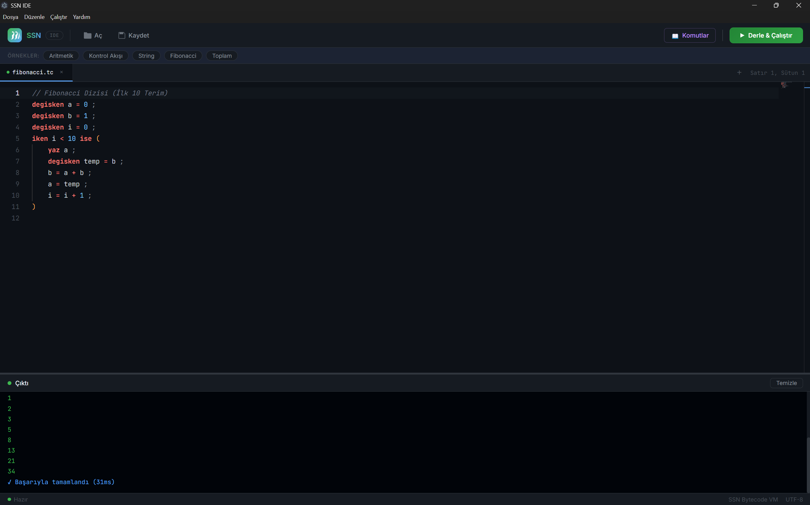
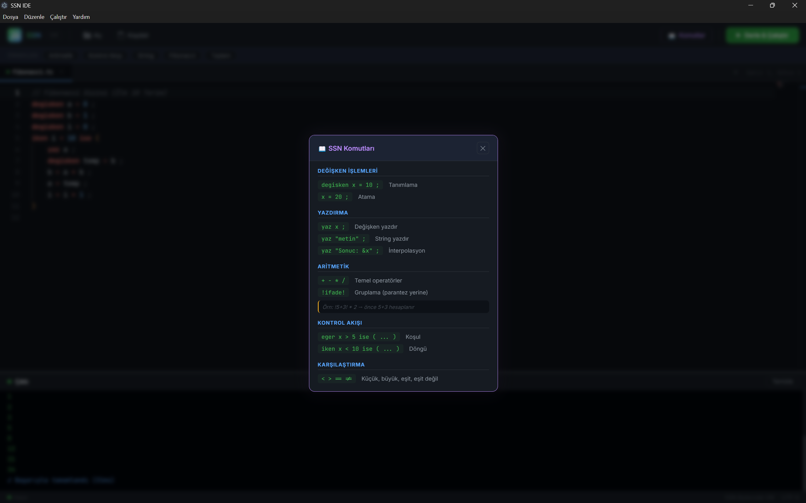

# SSN Derleyici

[English](README.md) | **Türkçe**

[](https://github.com/SelamiKalay/SSN-Derleyici/actions/workflows/ci.yml)



Türkçe anahtar kelimeli bir programlama dili ve onun derleyicisi. Kaynak kod önce
bytecode'a derlenir, ardından yığın (stack) tabanlı bir sanal makinede çalıştırılır.
Derleyici hiçbir dış kütüphane kullanmadan, sıfırdan C++17 ile yazılmıştır.

```
Kaynak Kod → Lexer → Parser → AST → Compiler → Bytecode → VM
```

## Örnek

```
// Fibonacci dizisi (ilk 10 terim)
degisken a = 0 ;
degisken b = 1 ;
degisken i = 0 ;
iken i < 10 ise (
    yaz a ;
    degisken temp = b ;
    b = a + b ;
    a = temp ;
    i = i + 1 ;
)

degisken x = !5 + 3! * 2 ;
yaz "Sonuc: &x" ;
```

## Dil Özellikleri

<p align="center"></p>

| Yapı | Söz dizimi |
|---|---|
| Değişken tanımlama | `degisken x = 5 ;` |
| Atama | `x = x + 1 ;` |
| Ekrana yazdırma | `yaz x ;` |
| Koşul | `eger x > 10 ise ( ... )` |
| Döngü | `iken i < 5 ise ( ... )` |
| Gruplama (parantez yerine) | `!5 + 3! * 2` |
| String interpolasyonu | `"Merhaba &isim"` |
| Satır sonu | `;` veya `é` |
| Yorum | `// satır sonuna kadar` |

- Aritmetik: `+ - * /` (operatör önceliğiyle)
- Karşılaştırma: `< > == !=`
- Veri tipleri: sayı (ondalıklı) ve metin

### Tasarım notları

Söz diziminin bazı noktaları ilk bakışta alışılmadık görünebilir; nedenleri şunlar:

- **Anahtar kelimeler Türkçe ama ASCII yazılır** (`degisken`, `eger`). Lexer kaynak
  kodu bayt bayt okur ve tanımlayıcılarda yalnızca `a-z`, `A-Z`, `_` ve rakamları
  kabul eder. `ğ`, `ş`, `ı` gibi harfler UTF-8'de birden çok bayt tuttuğu için
  desteklenmez; `değişken` yazılırsa derleyici hangi karakterin sorun olduğunu
  gösteren açıklayıcı bir hata verir ve `degisken` yazılmasını önerir.
- **Parantezler bloklar içindir, gruplama `!…!` ile yapılır.** `eger`/`iken`
  gövdeleri `( … )` içine yazıldığından aynı karakterin ifadelerde gruplama için
  de kullanılması ayrıştırmayı belirsizleştirirdi. Bu yüzden `!5 + 3! * 2`
  yazılır. `!=` operatörü bir sonraki karaktere bakılarak gruplamadan ayrılır.
- **Her yapı bir anahtar kelimeyle başlar, koşul `ise` ile biter.** `iken i < 10 ise ( … )`
  biçimi Türkçe cümle sırasına ("i 10'dan küçük iken") tam uymaz, ama parser'ın
  her ifadenin türünü ilk token'a bakarak belirlemesini sağlar (recursive
  descent). `eger` ve `iken` aynı kalıbı kullanır.
- **Satır sonu `;` veya `é`.** İkisi tamamen eşdeğerdir. `é`, lexer'ın özel olarak
  tanıdığı tek çok baytlı (UTF-8: `0xC3 0xA9`) karakterdir; ASCII olmayan bir
  karakterin bayt düzeyinde nasıl eşleştirildiğini gösteren bir örnek olarak dilde
  bırakılmıştır.

## Derleyici Aşamaları

- **Lexer** (`src/lexer.cpp`) — anahtar kelimeler, sayılar, metinler, `&değişken`
  interpolasyonu ve UTF-8 `é` karakteri dahil tokenizasyon
- **Parser** (`src/parser.cpp`) — recursive descent ile AST üretimi, satır numaralı
  hata mesajları
- **Compiler** (`src/compiler.cpp`) — AST'den bytecode üretimi (koşullu/koşulsuz
  sıçramalar, string birleştirme)
- **VM** (`src/vm.cpp`) — 18 opcode'lu yığın tabanlı sanal makine
- `--debug` modu: token listesi ve bytecode disassembly çıktısı

## IDE'ler

- **desktop-ide/** — Electron + Monaco Editor tabanlı masaüstü IDE (söz dizimi
  renklendirme, otomatik tamamlama, hazır örnekler, `Ctrl+Enter` ile derle & çalıştır)
- **web-ide/** — Node.js/Express sunuculu tarayıcı tabanlı IDE (`SSN_IDE.bat` ile başlatılır)

İki IDE de `src/` altından derlenen aynı derleyiciyi (`ssn`) kullanır. Derleyiciyi
şu sırayla ararlar: `SSN_COMPILER` ortam değişkeni, ardından proje kökündeki
`build/Release/ssn.exe`, `build/ssn.exe` ve `build/ssn`, en son da IDE klasöründeki
eski `compiler.exe`.

## Derleme ve Çalıştırma

Derleyici (CMake + C++17 derleyici gerekir):

```bash
cmake -B build -DCMAKE_BUILD_TYPE=Release
cmake --build build --config Release
```

```bash
ssn program.tc                  # programı çalıştırır
ssn --debug program.tc          # token ve bytecode çıktısını da gösterir
```

Masaüstü IDE (önce derleyiciyi yukarıdaki gibi derleyin):

```bash
cd desktop-ide
npm install
npm start
```

## Testler

`tests/ornekler/` altındaki her `.tc` programının çıktısı yanındaki `.out` dosyasıyla
karşılaştırılır; `tests/hatali/` altındaki programların ise hata vermesi beklenir.
Testler her push'ta GitHub Actions üzerinde çalışır.

```bash
bash tests/run_tests.sh build/ssn
```

## Kullanılan Teknolojiler

C++17 · CMake · Electron · Monaco Editor · Node.js / Express
